<a href="#selected-work">
  <picture>
    <source media="(prefers-color-scheme: dark)" srcset="assets/hero-dark.svg">
    <source media="(prefers-color-scheme: light)" srcset="assets/hero-light.svg">
    
  </picture>
</a>

I build full-stack products with AI at the core, and I care about what happens after the demo: production deploys, payment flows, and agents that ask before they act.

**[See Stayzy live](https://stayzy.shahim.dev)** &nbsp;·&nbsp; **[Read the code](https://github.com/mohammedshahim/stayzy-ai-hotel-booking)** &nbsp;·&nbsp; **[Browse all repositories](https://github.com/mohammedshahim?tab=repositories)**

## Selected work

<a href="https://stayzy.shahim.dev">
  <picture>
    <source media="(prefers-color-scheme: dark)" srcset="assets/stayzy-dark.svg">
    <source media="(prefers-color-scheme: light)" srcset="assets/stayzy-light.svg">
    
  </picture>
</a>

Four separately deployed apps: the guest site, an admin panel, the API and a Python agent service. The chatbot pauses for the guest's approval before it changes anything. [Live site](https://stayzy.shahim.dev) · [Source](https://github.com/mohammedshahim/stayzy-ai-hotel-booking)

<a href="https://github.com/mohammedshahim/job-pilot">
  <picture>
    <source media="(prefers-color-scheme: dark)" srcset="assets/jobpilot-dark.svg">
    <source media="(prefers-color-scheme: light)" srcset="assets/jobpilot-light.svg">
    
  </picture>
</a>

<a href="https://github.com/mohammedshahim/ai-stay-vista-hotel-booking">
  <picture>
    <source media="(prefers-color-scheme: dark)" srcset="assets/vista-dark.svg">
    <source media="(prefers-color-scheme: light)" srcset="assets/vista-light.svg">
    
  </picture>
</a>

## How I got here

<a href="https://github.com/mohammedshahim?tab=repositories">
  <picture>
    <source media="(prefers-color-scheme: dark)" srcset="assets/timeline-dark.svg">
    <source media="(prefers-color-scheme: light)" srcset="assets/timeline-light.svg">
    
  </picture>
</a>

## What I work with

<a href="https://github.com/mohammedshahim?tab=repositories">
  <picture>
    <source media="(prefers-color-scheme: dark)" srcset="assets/stack-dark.svg">
    <source media="(prefers-color-scheme: light)" srcset="assets/stack-light.svg">
    
  </picture>
</a>

## From the lab

| Project | What it explores |
| :--- | :--- |
| [rag-gigs](https://github.com/mohammedshahim/rag-gigs) | Retrieval-augmented generation with LangChain and Pinecone |
| [LangGraph gigs](https://github.com/mohammedshahim/LangGrapg-gigs) | LangGraph agents with tool calling and Tavily web search |
| [fastmcp-sample](https://github.com/mohammedshahim/fastmcp-sample) | MCP servers connected to a LangGraph client |
| [fastapi-k8s-microservice](https://github.com/mohammedshahim/fastapi-k8s-microservice) | Four FastAPI services, each with a Dockerfile and Kubernetes manifest |
